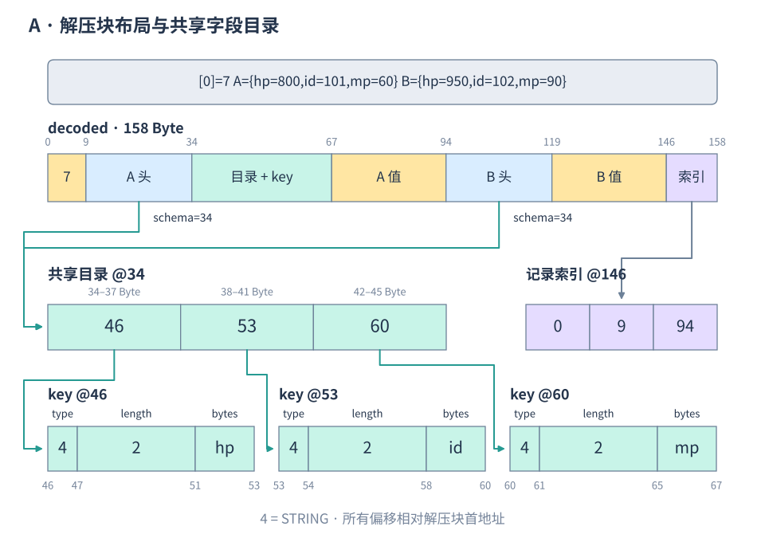
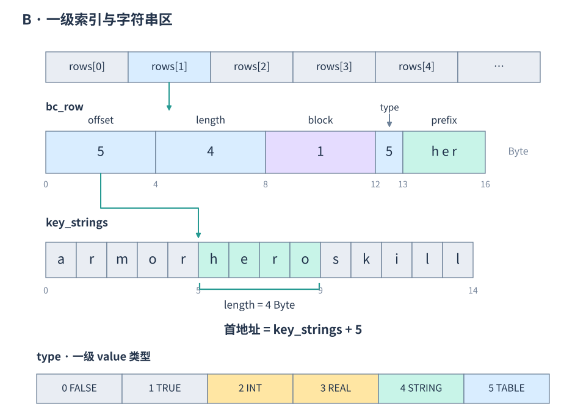
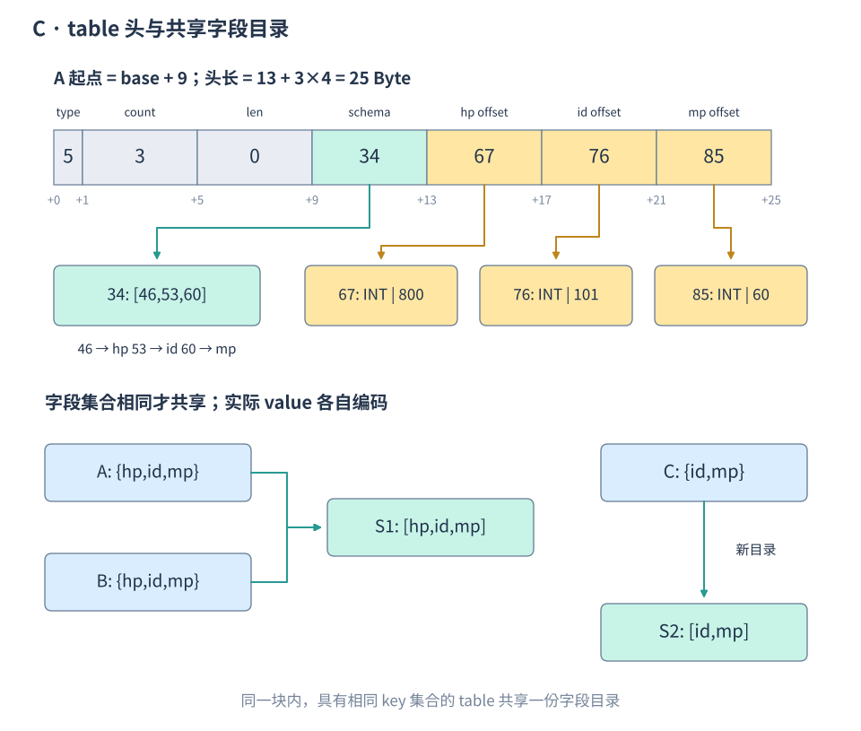

最近对 sharedata 做了一点内存优化，但是下个版本我们就改成全用 sharetable 了，怪可惜的，写一点博客记录一下。

我们现在的节点比较复杂，有一些是用于组网的节点，但是还加载了所有配置表，内存占用比较高。于是搞了懒加载，没有实际读取配置表的时候，就不读取对应的配置文件。这里第一版实现引入了 skynet.call，后面改成了同步阻塞加载，首次访问的补载路径不发消息，也不会 yield。这套方案只在内网环境使用，第一次读到表的时候卡一下。

后面因为抽取表比较大，首次加载比较慢，客户端那边为了对齐表现，调大了时间，反而跟线上情况不一致了。于是，又加了分块压缩：将一级 key 排序，默认每块最多放 64 个 key 对应的 value，同时以 256 KiB 的解压体积为阈值提前切块，再用 zstd 压缩。访问具体字段时，才按需解压对应的块。

这里的 “ 按需 ” 主要是控制长期驻留的解压数据。首次访问一张表时，仍然要完整读取、执行配置文件，并构建整张表的压缩块，完成后关闭临时 Lua state。因此首次构建还是有延迟和内存峰值，特别大的表可以提前在启动阶段加载。

同一个进程里的各个 Lua state 共享 C 侧的压缩数据和解压缓存。默认每张表最多保留 8 MiB 的解压缓存，不够时按 LRU 淘汰这张表里最久没用的解压块。这个预算不包括压缩数据、一级索引和元数据，多张表的缓存也会相加，不能当成整个进程的内存上限。

分块还有个边界：一条一级记录内部的嵌套表不会继续拆开。如果单条记录就超过 256 KiB，它还是会独占一个大块；如果连这张表的解压缓存预算也超过了，就只能临时解压，当前读取结束后释放，下次再读还得重新解压。所以一级 key 很少、数据都塞在一个大 value 里的表，还是要单独看一下块大小和缓存预算。

解压后也不会为每个服务重新构建 Lua table，而是在 C 侧直接查询紧凑的二进制结构，Lua 侧只保留只读的路径代理。长期持有子表代理不会钉住解压块，淘汰后再访问可以重新解压，热更后也会沿着路径读取当前版本。

为了提高缓存局部性，一级索引用连续数组保存，字符串 key 则合并到另一段连续字节区里。在当前 x64 构建下，每条一级索引从 48 Byte 缩到了 16 Byte。块内字段集合相同的 table 还会共享一份字段结构，连续数组则省掉显式 key，只保存 value 的偏移。

一级 key 采用二分查找。字符串 key 还利用了索引结构原有的 3 Byte 尾部对齐空隙，存下前三个字节：前缀不同就能决定二分方向，不用再访问字符串区；前缀相同，再比较剩余字节和原始长度。如果整张表的字符串 key 前缀都一样，就直接跳过这层筛选。这个优化主要对前缀比较分散的 key 有用，共同长前缀的场景没有稳定收益。

还尝试了 Eytzinger 布局，把二叉搜索树按层排到连续数组里。部分纯 C 索引查询明显更快，不过收益没有稳定传递到 Lua 代理读取，共同长前缀和遍历场景还有明显回退，所以目前没有实际用上，仍然保留有序数组二分，以后有机会再试。

目前观察到的整体容器内存占用大概从 12G 变成了 3G，加入分块后又减少了约 10%，效果还行
